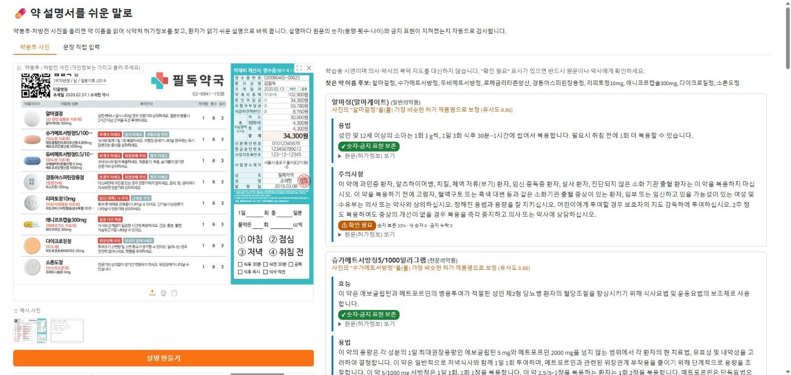

# 💊 PillBag: 약봉투 사진 → 쉬운 복약 설명

약봉투나 약 이름이 찍힌 사진을 올리면 OCR로 약 이름을 읽고, 식약처 허가정보의 어려운 설명(효능·용법·주의사항)을 **KoBART로 쉬운 말로 바꿔** 보여주는 프로젝트입니다.

> 학습용 시연이며 의사·약사의 복약 지도를 대신하지 않습니다.

**▶ 데모: [http://3.36.101.140:7860](http://3.36.101.140:7860/)** · AI 활용 기록: [AI_LOG.md](AI_LOG.md)



## 파이프라인
```
사진 → 이미지 보정 → EasyOCR(약 이름 인식) → 식약처 허가정보 API 조회
     → KoBART 쉬운 말 변환(섹션별) → 사실성 재순위화(숫자·금지표현 보존) → Gradio 화면
```

## 데이터
- 식약처 공공데이터(data.go.kr): **의약품 허가정보**(원문) ↔ **e약은요**(쉬운 설명) 를 품목·섹션(효능/용법/주의사항) 단위로 매칭해 학습쌍 구축 (`fetch_mfds.py`, `build_pairs.py`, `prep.py`)
- 데이터 누수 점검: 테스트 정답의 약 29%가 학습셋에 그대로 존재 → 중복 제거한 `_filt` 학습셋으로 재학습 (`leak_check.py`, `make_train_filt.py`)

## 모델 / 실험
- `gogamza/kobart-base-v2`, `gogamza/kobart-summarization` 파인튜닝, seed 3개 반복 (`train.py`, `run_main.sh`)
- 비교군: 원문 복사(copy), 규칙 기반 치환(rule), Qwen2.5-7B-Instruct 제로샷 (`baselines.py`, `llm_baseline.py`)
- **사실성 재순위화(fact_rerank)**: 빔 후보 중 원문 숫자(용량·횟수) 보존율이 높고 새 숫자·‘금지’ 표현 누락이 적은 문장 선택 (`metrics.py`, `gen_cands.py`)

## 결과 (테스트셋, seed 3개 평균±표준편차)
| 방법 | SARI | chrF | 숫자 보존율(%) ↑ | 새 숫자/100 ↓ | 금지표현 누락(%) ↓ |
|---|---|---|---|---|---|
| copy | 13.1 | 48.6 | 100.0 | 0.0 | 0.0 |
| rule | 33.2 | 47.2 | 100.0 | 0.0 | 0.0 |
| Qwen2.5-7B (zero-shot) | 34.0 | 31.0 | 83.7 | 1.6 | 7.4 |
| KoBART-summ (plain) | 68.9±0.3 | 71.4±0.7 | 76.5±0.5 | 15.6±0.7 | 5.0±1.1 |
| **KoBART-summ + fact_rerank** | **68.9±0.1** | **72.0±0.6** | **80.5±0.5** | **14.7±1.0** | **3.6±1.0** |

- 재순위화만으로 숫자 보존율 +4%p, 금지표현 누락 −1.4%p (SARI 유지)
- 상세: `results/summary.txt`, `results/improve_summary.json`, 어텐션 시각화 `results/attn_yongbeop.png`

## 실행
```bash
pip install -r requirements.txt
cp .env.example .env   # data.go.kr 인증키 입력
bash run_main.sh       # 데이터 구축 → 베이스라인 → 학습 → 집계
python web_app.py      # Gradio 데모 (ckpt/ 에 학습된 가중치 필요)
```
노트북 데모: `pillbag_app.ipynb`

> 모델 가중치(`ckpt/`)와 원본 데이터(`data/`)는 용량·라이선스 문제로 저장소에 포함하지 않았습니다.

## 기술 스택
Python · PyTorch · Hugging Face Transformers · EasyOCR · Gradio · 공공데이터 API

